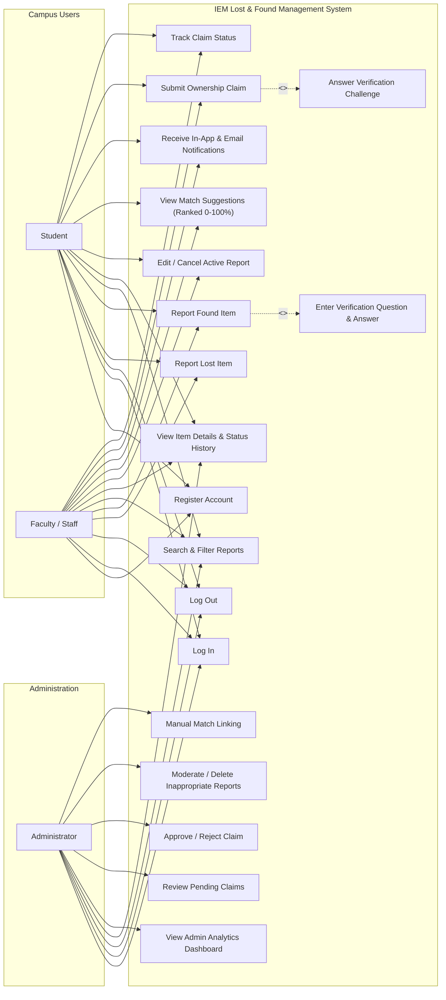
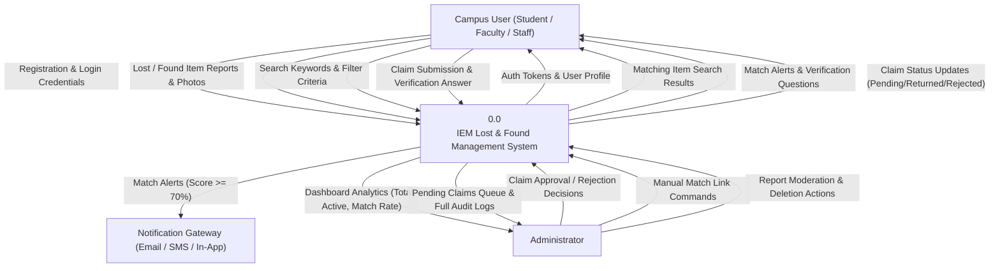
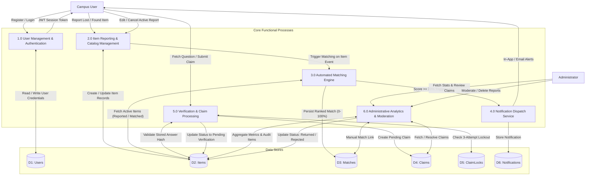
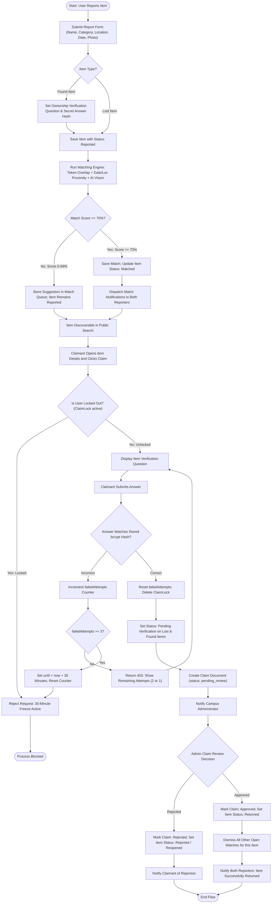
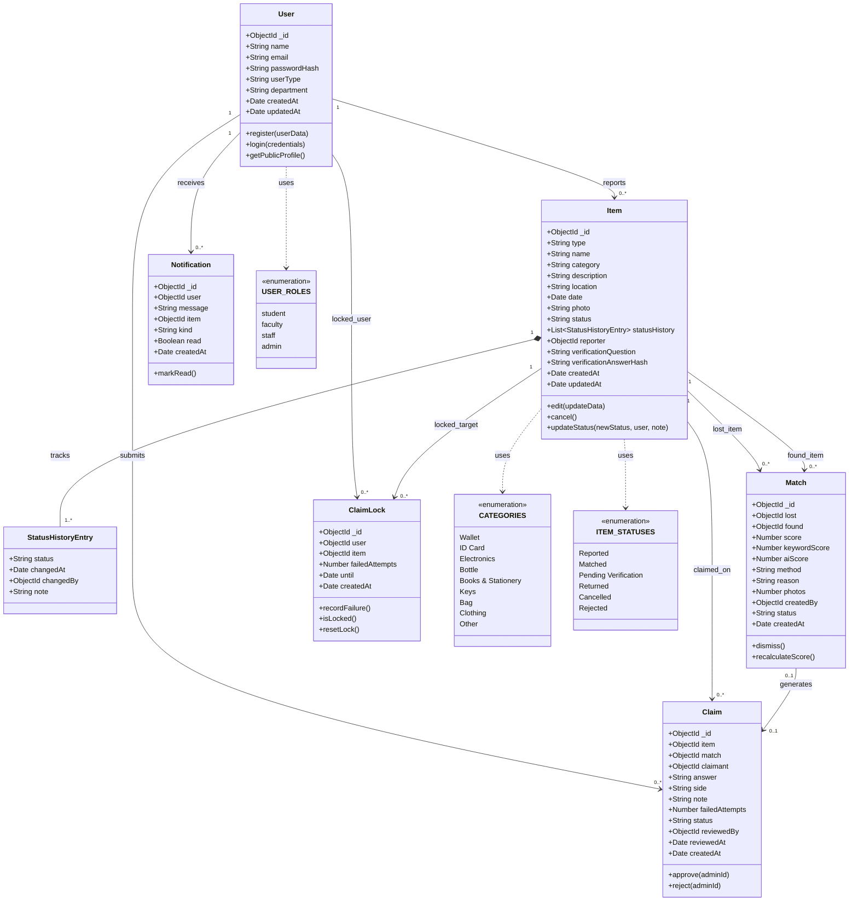
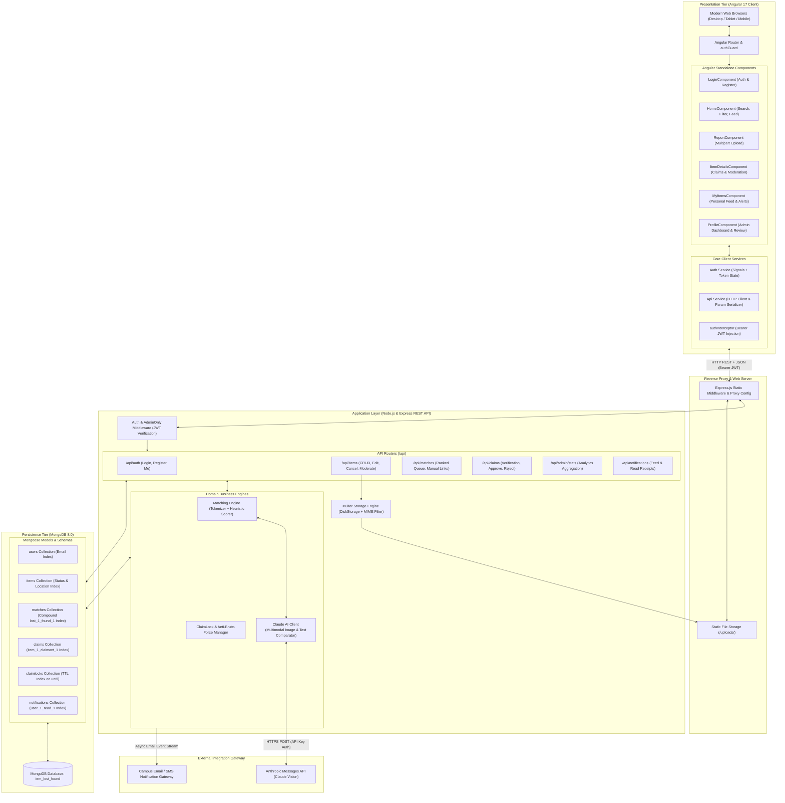
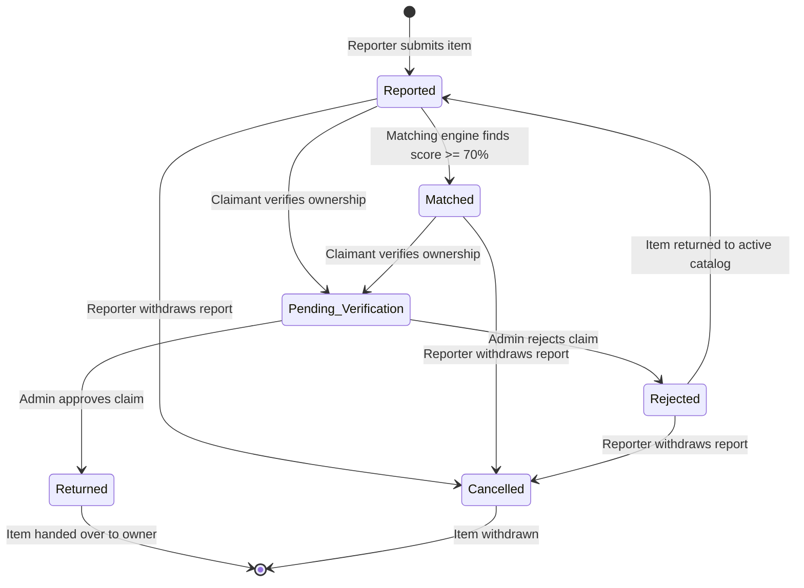

# IEM Lost & Found Management System
## Software Requirements Specification, System Architecture & Software Test Design Document

**Institute of Engineering & Management (IEM), Kolkata**  
**Department of Computer Science & Engineering**  
*Course:* Software Engineering and Project Management (PCC-CS504) | Semester V  
*Team / Group:* P8, Section B  
*Project Title:* IEM Lost & Found Management System  
*Technology Stack:* MEAN Stack (MongoDB, Express.js, Angular 17, Node.js) + Multimodal AI Matcher  

---

## 1. System Overview & Product Scope

The **IEM Lost & Found Management System** is a centralized, role-based web application tailored for students, faculty, staff, and campus security/administrators across the IEM campus. It addresses the inefficiencies of lost property management by automating the end-to-end recovery lifecycle:

1. **Intelligent Categorization & Ingestion:** Standardized lost and found reporting with predefined categories, location tags, date/time timestamps, photo uploads, and anti-fraud verification challenges.
2. **Dual-Layer Matching Engine:** An automated engine computing deterministic similarity scores (0–100%) across category, text token overlap, campus location, and date proximity, backed by an optional multimodal Anthropic Claude AI evaluator for image and text semantic reasoning.
3. **Threshold-Based Notifications:** Automated notification dispatch whenever a candidate match reaches or exceeds the 70% threshold.
4. **Three-Tier Claim Verification & Anti-Brute-Force Protection:** Item-specific ownership questions with bcrypt hash validation and a strict 3-attempt lockout (30-minute freeze) to eliminate claim fraud.
5. **Administrative Oversight & Analytics:** Admin workflow for reviewing pending claims, approving/rejecting handovers, moderating inappropriate reports, and monitoring real-time dashboard analytics (total reports, active reports, match rates, average time-to-match).

---

## 2. Requirements Specification

### 2.1 Functional Requirements (FR-01 to FR-20)

| FR ID | Priority | Requirement Statement | Inputs | Processing Logic | Outputs / System State |
|:---:|:---:|---|---|---|---|
| **FR-01** | High | The system shall allow students, faculty, and staff to register using their name, institutional email (`@iemcal.edu.in` or `@iem.edu.in`), user type, and password. | Name, institutional email, department, user type (`student`, `faculty`, `staff`), password (≥ 6 chars). | Validates domain regex; hashes password with bcrypt (10 rounds); ensures email uniqueness. | New `User` record stored; JWT auth token and user profile returned. |
| **FR-02** | High | The system shall authenticate registered users using email and password before granting access to protected functions. | Email, password. | Queries user with `+passwordHash`; verifies password via bcrypt; signs 7-day JWT. | JWT token; client sets session signal and `authGuard` unlocks routes. |
| **FR-03** | Medium | The system shall allow users to search reports using item name or keywords and display matching results. | Search query string `q`. | Case-insensitive regex query against `name`, `location`, and `description` on active reports. | List of matching `Item` cards sorted by `createdAt` descending. |
| **FR-04** | High | The system shall allow users to filter reports by category, location, date range, and lost/found type. | Query params: `type`, `category`, `location`, `fromDate`, `toDate`. | MongoDB filter query combining indexed fields, regex location matching, and `$gte`/`$lte` date range. | Filtered subset of active items matching all applied criteria. |
| **FR-05** | High | The system shall provide a predefined category taxonomy (Wallet, ID Card, Electronics, Bottle, Books & Stationery, Keys, Bag, Clothing, Other). | Category selection from UI dropdown. | Validates input against system `CATEGORIES` enum at API and schema layer. | Item categorized under standard tag, improving matching precision. |
| **FR-06** | High | The system shall display the details, reporter information, and current status of an individual report to authorized users. | Item ID (`ObjectId`), JWT Bearer token. | Validates token; fetches item; populates reporter (`name`, `department`, `userType`); checks ownership. | Detailed view with photo, description, location, status badge, and history timeline. |
| **FR-07** | Medium | The system shall allow the original reporter to edit an active report before it is returned or closed. | Item ID, updated fields (`name`, `category`, `description`, `location`, `date`, `photo`). | Confirms `req.user.id == item.reporter`; verifies status is active (`Reported` or `Matched`); logs `statusHistory`. | Updated `Item` document; background re-matching triggered. |
| **FR-08** | High | The system shall allow the original reporter to cancel an active report, removing it from public search. | Item ID, cancellation command. | Verifies ownership and active state; transitions status to `Cancelled`; dismisses suggested matches. | Item removed from public queue; status updated with audit log. |
| **FR-09** | Medium | The system shall allow authenticated users to log out and terminate their active session. | Logout trigger from client UI. | Clears browser `localStorage` (`token`, `user`); resets authentication reactive signals. | Client redirected to `/login`; subsequent requests reject with 401. |
| **FR-10** | Medium | The system shall compare lost and found reports using category, description, location, date/time, and photo similarity. | Triggered on item creation/edit or manual re-match request. | Evaluates keyword/token overlap (name 30%, category 30%, desc 15%, location 15%, date proximity 10%) + Claude AI vision model. | Calculated integer match score between 0 and 100%. |
| **FR-11** | High | The system shall allow users to report a lost item with item name, category, description, location, date, and optional photo. | Lost report form fields + multipart photo file. | Validates required fields; stores file in `/uploads`; sets initial status to `Reported`. | New `Item` created; background matching pipeline kicked off. |
| **FR-12** | High | The system shall reject incorrect verification answers and lock claims for 30 minutes after 3 consecutive failed attempts. | User ID, Item ID, submitted verification answer. | Compares normalized answer with stored bcrypt hash; increments `ClaimLock.failedAttempts`; sets `until = now + 30m` on 3rd failure. | HTTP 403 with attempts remaining, or HTTP 423 lockout response. |
| **FR-13** | High | The administrator dashboard shall display total reports, active reports, matched items, pending claims, returned items this month, and avg time-to-match. | Admin dashboard request (`GET /api/admin/stats`). | Executes parallel aggregation across `Item`, `Match`, and `Claim` collections. | JSON dashboard statistics payload rendered in 6-card widget grid. |
| **FR-14** | High | The system shall maintain item statuses as `Reported` → `Matched` → `Pending Verification` → `Returned`, with `Cancelled` and `Rejected` as terminal/branch states. | Lifecycle events (match detected, claim filed, admin review, reporter cancellation). | Enforces state transition validation and records every transition in `statusHistory` array. | Updated item status and append-only audit trail with timestamps and user references. |
| **FR-15** | High | The system shall generate in-app and external notifications when a match score reaches or exceeds 70%. | Candidate match score calculation result. | Checks `score >= 70`; creates dual `Notification` records (for both lost and found reporters). | In-app notification with blue unread dot on "My Items" tab; simulated email alert. |
| **FR-16** | High | The administrator shall be able to review claims, approve/reject handovers, moderate inappropriate reports, and delete records. | Admin ID, claim/item ID, action (`approve`, `reject`, `remove`, `delete`). | Updates claim state; updates item status to `Returned`/`Rejected`/`Cancelled`; cascades dismissals. | Item marked `Returned` or released; notifications sent to claimants; inappropriate items purged. |
| **FR-17** | High | The system shall allow a user to submit a claim for a found item by identifying their relevant lost report. | Found Item ID, Lost Item ID (or Match ID), verification answer, optional note. | Verifies claimant does not own the found item; verifies answer; links reports in a new `Claim` document. | Items transitioned to `Pending Verification`; admin notified for review. |
| **FR-18** | Medium | The system shall assign each candidate match an integer score from 0% to 100% and present higher-scoring matches first. | Match query for item or global admin queue. | Queries `Match` collection filtered by item ID; sorts by `-score`. | Ranked list of match suggestions with similarity percentage badges. |
| **FR-19** | High | The system shall require the claimant to correctly answer an item-specific verification question before a claim can be escalated. | Claimant's answer string. | Fetches question without exposing answer (`select: false`); compares lowercase trimmed answer with bcrypt hash. | Prevents unauthorized claim creation; blocks fraudulent handovers. |
| **FR-20** | High | The system shall allow users to report a found item with name, category, description, location, date, photo, verification question, and answer. | Found report form fields + verification challenge & answer. | Hashes secret answer with bcrypt (8 rounds); sets answer field `select: false`. | Item listed as `Reported` in found pool; verification challenge secured. |

---

### 2.2 Non-Functional Requirements (NFR-01 to NFR-05)

* **NFR-01 (Performance):** Under a concurrency load of up to 100 simultaneous users, at least 95% of standard HTTP transactions (search, view, browse, claim submission) must return with a response latency under 3.0 seconds.
* **NFR-02 (Scalability):** The backend architecture and database schema must sustain at least 10,000 registered users, 100,000 item reports, and a daily throughput of 1,000 new reports without requiring database sharding or breaking schema redesigns. Compound indexing (`lost_1_found_1`, `user_1_item_1`) guarantees sub-50ms lookup times.
* **NFR-03 (Security & Data Confidentiality):**
  * Passwords must be hashed using bcrypt (cost factor 10) and excluded by default from query results (`select: false`).
  * Verification answers must be hashed with bcrypt; the plain text or hashed answer must never be transmitted over the API or exposed in the Angular client bundle.
  * Role-Based Access Control (RBAC) must restrict administrative endpoints (`/api/admin/*`, `/api/claims`, moderation) exclusively to users with `userType: 'admin'`.
  * Claims must be locked for 30 minutes after 3 consecutive wrong answers via MongoDB TTL indexes.
* **NFR-04 (Reliability & Data Integrity):**
  * The system must maintain 99.0% operational availability during academic operating hours.
  * Atomic transitions (`findOneAndUpdate`) must prevent race conditions (e.g., two users claiming the same found item simultaneously).
  * Incomplete or malformed inputs must be rejected by Express schema validation and Mongoose validation rules before mutating state.
* **NFR-05 (Accuracy & Usability):**
  * The matching engine must accurately associate at least 85% of valid lost-found pairs in an experimental benchmark of 100 known pairs.
  * The Angular user interface must conform to the institutional Figma design guidelines, supporting responsive rendering across mobile viewports (≤ 520px) and desktop screens, allowing ≥ 80% of test users to submit reports unaided.

---

### 2.3 Interface Requirements (IR-01 to IR-05)

* **IR-01 (User Interface):** A single-page, responsive Angular 17 interface designed around a mobile frame layout that adapts to full-screen on mobile devices, providing intuitive navigation tabs (*Home*, *Report*, *My Items*, *Profile*).
* **IR-02 (Registration & Login Interface):** A dual-state authentication card providing institutional email validation, dynamic department selection, and role toggling (`student`, `faculty`, `staff`).
* **IR-03 (Item Reporting Interface):** A reactive multipart form supporting image drag-and-drop / file upload, segmented button selection (*I Lost Something* vs. *I Found Something*), category picker, and conditional verification question/answer fields.
* **IR-04 (Search & Matching Interface):** An integrated search header featuring real-time debounce search, segmented type pills (*All*, *Lost*, *Found*), collapsible multi-criteria filters (category dropdown, location input, date range pickers), and match suggestion cards with visual similarity badges.
* **IR-05 (Administrator Interface):** An administrative command center in the *Profile* view containing a 6-metric statistics dashboard, manual match linking tool, real-time match suggestion moderation queue, pending claim review panel with one-click approve/reject actions, and report moderation controls.

---

## 3. System Modeling & UML Diagrams

### 3.1 Use Case Diagram

The use case diagram illustrates the interactions between the primary campus actors (**Student**, **Faculty/Staff**) and the secondary actor (**Administrator**), outlining functional boundaries and `<<include>>` relationships.



---

### 3.2 Data Flow Diagrams (DFD)

#### 3.2.1 Level 0 — Context Level DFD
The Level 0 Context Diagram establishes the boundary of the system, identifying external entities and high-level information exchanges.



#### 3.2.2 Level 1 — Detailed DFD
The Level 1 DFD decomposes the system into six core processes and six primary data stores.



---

### 3.3 Activity Diagram

The activity diagram models the operational lifecycle of lost and found recovery, including matching thresholds, three-attempt verification lockout, and administrative approvals.



---

### 3.4 Sequence Diagram

The sequence diagram documents the chronological communication across all system layers during an end-to-end claim and verification cycle.

```mermaid
sequenceDiagram
    autonumber
    actor Claimant as Campus Claimant
    participant UI as Angular 17 Client
    participant AuthGuard as Client AuthGuard / Interceptor
    participant API as Express API Router
    participant Matcher as Matching Engine
    participant DB as MongoDB (Mongoose)
    actor Admin as Administrator

    Claimant->>UI: Navigate to found item details
    UI->>AuthGuard: Verify JWT session
    AuthGuard-->>UI: Session valid (Bearer Token)
    UI->>API: GET /api/items/:id/question
    API->>DB: Query ClaimLock (user, item)
    DB-->>API: No active lock found
    API->>DB: Query Item.findById(id).select('verificationQuestion')
    DB-->>API: Return verificationQuestion
    API-->>UI: { question: "What sticker is on the bottle?" }
    UI-->>Claimant: Render verification challenge prompt

    Claimant->>UI: Enter answer ("cat sticker") & click Submit Claim
    UI->>API: POST /api/items/:id/claim { answer: "cat sticker" }
    API->>DB: Item.findById(id).select('+verificationAnswerHash')
    DB-->>API: Item record with bcrypt hash

    API->>API: bcrypt.compare(normalizedAnswer, hash)
    alt Verification Answer Correct
        API->>DB: ClaimLock.deleteOne({ user, item })
        API->>DB: Item.findOneAndUpdate(status: 'Pending Verification', push statusHistory)
        API->>DB: Claim.create({ item, claimant, answer, status: 'pending_review' })
        API->>DB: Notification.create({ user: admin, kind: 'claim' })
        API-->>UI: 201 Created: Claim pending admin review
        UI-->>Claimant: "Answer verified! Your claim is pending admin review."
    else Verification Answer Incorrect (Attempts < 3)
        API->>DB: ClaimLock.findOneAndUpdate(increment failedAttempts)
        API-->>UI: 403 Forbidden: "Incorrect answer. 2 attempts remaining."
        UI-->>Claimant: Display warning banner
    else Verification Answer Incorrect (3rd Failure)
        API->>DB: ClaimLock.findOneAndUpdate(until: now + 30 min, failedAttempts: 0)
        API-->>UI: 423 Locked: "3 failed attempts. Locked for 30 minutes."
        UI-->>Claimant: Display lockout countdown banner
    end

    Note over API,Admin: Administrative Verification & Review Phase
    Admin->>UI: Open Admin Profile / Dashboard
    UI->>API: GET /api/admin/stats & GET /api/claims
    API->>DB: Aggregate stats & populate pending claims
    DB-->>API: Return stats & claims payload
    API-->>UI: Render dashboard widgets & pending claims table
    
    Admin->>UI: Click "Approve Claim"
    UI->>API: POST /api/claims/:id/approve
    API->>DB: Claim.findByIdAndUpdate(status: 'approved', reviewedBy: admin)
    API->>DB: Item.updateMany(status: 'Returned', push statusHistory)
    API->>DB: Match.updateMany(status: 'dismissed' for competing matches)
    API->>DB: Notification.create(handover confirmation to claimant & reporter)
    API-->>UI: 200 OK: Claim approved
    UI-->>Admin: Update UI; item badge becomes "RETURNED"
```

---

### 3.5 Design Diagram — UML Class Diagram

The class diagram captures the object-oriented structure of the data domain, demonstrating MongoDB Mongoose models, enums, subdocuments, and their relational cardinality.



---

### 3.6 High-Level Architecture Diagram (HLD)

The multi-tier architecture illustrates the decoupling between the Angular client presentation tier, the Node.js Express service layer, the persistence data layer, and external AI/Notification gateways.



---

## 4. Software Testing Techniques

### 4.1 Black-Box Testing Techniques

#### 4.1.1 Equivalence Class Partitioning (ECP)
Equivalence Partitioning separates inputs into valid and invalid partitions where test cases assume equal behavior across any representative value.

| Domain Under Test | Equivalence Class ID | Description | Class Type | Representative Input | Expected System Behavior |
|---|---|---|---|---|---|
| **Match Score Validation** | **ECP-MS-01** | Negative integer | Invalid | `score = -1` | Rejected with HTTP 400 validation error; match not persisted. |
| | **ECP-MS-02** | Valid score, below threshold | Valid | `score = 45` | Match saved with status `suggested`; no notification generated. |
| | **ECP-MS-03** | Valid score, at or above threshold | Valid | `score = 85` | Match saved with status `suggested`; match notifications triggered. |
| | **ECP-MS-04** | Value above maximum percentage | Invalid | `score = 105` | Rejected with HTTP 400 validation error; match not persisted. |
| | **ECP-MS-05** | Non-numeric or missing score | Invalid | `score = "high"`, `null` | Rejected with HTTP 400 validation error; match not persisted. |
| **Email Domain Validation** | **ECP-EM-01** | Approved institutional domain | Valid | `student@iemcal.edu.in` | Account created successfully; HTTP 201 Created. |
| | **ECP-EM-02** | Secondary approved campus domain | Valid | `admin@iem.edu.in` | Account created successfully; HTTP 201 Created. |
| | **ECP-EM-03** | Public non-institutional email | Invalid | `user@gmail.com` | Rejected with HTTP 400: "Please use your institutional email". |
| **Claim Verification Lock** | **ECP-LK-01** | Claimant under attempt limit | Valid | `failedAttempts = 1` | Answer checked; returns HTTP 403 showing 1 attempt remaining. |
| | **ECP-LK-02** | Claimant exceeding 3 failures | Invalid | `failedAttempts = 3` | ClaimLock activated with `until = now + 30m`; returns HTTP 423. |

#### 4.1.2 Boundary Value Analysis (BVA)
Boundary Value Analysis targets testing at edges of input domains where defect density is highest.

| Test Case ID | Target Boundary | Input Value | Expected Result | Pass Criteria |
|---|---|---|---|---|
| **BVA-MS-01** | Score Just Below Min | `score = -1` | Rejected with validation error | No record in `matches` collection |
| **BVA-MS-02** | Score Exactly Min | `score = 0` | Stored; no notification | Saved with `score = 0` |
| **BVA-MS-03** | Score Just Above Min | `score = 1` | Stored; no notification | Saved with `score = 1` |
| **BVA-MS-04** | Notification Sub-Threshold | `score = 69` | Stored in suggestions; no alert | Zero notification records generated |
| **BVA-MS-05** | Notification Threshold | `score = 70` | Stored in suggestions; notification fired | Exactly two notifications created (lost/found) |
| **BVA-MS-06** | Notification Super-Threshold | `score = 71` | Stored in suggestions; notification fired | Exactly two notifications created |
| **BVA-MS-07** | Score Exactly Max | `score = 100` | Stored; notification fired | Saved with `score = 100` |
| **BVA-MS-08** | Score Just Above Max | `score = 101` | Rejected with validation error | No record in `matches` collection |
| **BVA-LK-01** | Verification Attempt 2 | 2nd wrong answer | Rejected; remaining attempts = 1 | `ClaimLock.failedAttempts == 2`; HTTP 403 |
| **BVA-LK-02** | Verification Attempt 3 | 3rd wrong answer | 30-minute lockout enforced | `ClaimLock.until > now`; HTTP 423 |
| **BVA-LK-03** | Verification Post-Lock | 4th answer during lock | Rejected without answer check | HTTP 423 with lock expiration timestamp |

#### 4.1.3 Decision Table Testing
Applied to the claim verification and lockout mechanism where multiple conditions combine to determine authentication and authorization outcomes.

| Condition / Action | Rule 1 | Rule 2 | Rule 3 | Rule 4 | Rule 5 | Rule 6 | Rule 7 | Rule 8 |
|---|:---:|:---:|:---:|:---:|:---:|:---:|:---:|:---:|
| **C1: Authenticated Session (Valid JWT)?** | T | T | T | T | F | F | F | F |
| **C2: Claim Not Locked (`until <= now`)?** | T | T | F | F | T | T | F | F |
| **C3: Submitted Answer Matches Stored Hash?** | T | F | T | F | T | F | T | F |
| **Action A1: Transition Item to Pending Verification** | **X** | | | | | | | |
| **Action A2: Create Claim Document for Admin Review** | **X** | | | | | | | |
| **Action A3: Increment `failedAttempts` Counter** | | **X** | | | | | | |
| **Action A4: Enforce 30-Minute Lockout (if 3rd failure)** | | **X** | | | | | | |
| **Action A5: Return 423 Locked (Short-Circuit Evaluation)** | | | **X** | **X** | | | | |
| **Action A6: Return 401 Unauthorized (Redirect to Login)** | | | | | **X** | **X** | **X** | **X** |

#### 4.1.4 State Transition Testing
Verifies valid progression through the item lifecycle while rejecting invalid or illegal state mutations.



* **Valid Transitions Verified:**
  * `Reported` → `Matched` (automatic upon score calculation ≥ 70%).
  * `Reported` / `Matched` → `Pending Verification` (successful ownership verification).
  * `Pending Verification` → `Returned` (administrative claim approval).
  * `Pending Verification` → `Rejected` (administrative claim denial).
  * `Reported` / `Matched` → `Cancelled` (reporter withdrawal).
* **Invalid Transitions Rejected:**
  * `Returned` → `Reported` (prevents resurrecting completed handovers).
  * `Cancelled` → `Pending Verification` (prevents claiming withdrawn items).
  * Edit on `Returned` or `Cancelled` reports (blocked with HTTP 400).

---

### 4.2 White-Box Testing Techniques

#### 4.2.1 Statement & Decision Coverage Analysis
White-box testing guarantees that every logical branch and executable line of code within critical security and scoring algorithms is executed.

* **Target Statement Coverage:** ≥ 80% on core backend modules:
  * `server/src/matching.js` (Scoring and AI fallback pipelines).
  * `server/src/routes.js` (Authentication, Claim lockout, Moderation).
  * `server/src/models.js` (Validation schemas and pre-save hooks).
* **Target Decision / Branch Coverage:** 100% on decision predicates:
  * `data.score >= THRESHOLD()`
  * `item.status !== 'Reported' && item.status !== 'Matched'`
  * `record.failedAttempts >= 3`
  * `bcrypt.compare(normalizedAnswer, hash)`

#### 4.2.2 Basis Path Testing & Cyclomatic Complexity Analysis
Basis path testing is applied to the core ownership verification and anti-brute-force procedure: `verifyClaimAnswer()`.

##### Reference Logic
```javascript
function verifyClaimAnswer(claimLock, submittedAnswer, storedAnswerHash, now) {
  // Decision Node 1
  if (claimLock && claimLock.until && claimLock.until > now) {
    return { status: 'LOCKED', message: 'Account locked for 30 minutes' }; // Node 2
  }
  
  // Decision Node 3
  if (bcrypt.compareSync(submittedAnswer.trim().toLowerCase(), storedAnswerHash)) {
    claimLock.failedAttempts = 0; // Node 4
    return { status: 'VERIFIED', message: 'Ownership confirmed' }; // Node 4
  }
  
  claimLock.failedAttempts = (claimLock.failedAttempts || 0) + 1; // Node 5
  
  // Decision Node 6
  if (claimLock.failedAttempts >= 3) {
    claimLock.until = new Date(now.getTime() + 30 * 60 * 1000); // Node 7
    claimLock.failedAttempts = 0;                               // Node 7
    return { status: 'LOCKED', message: '3 failed attempts reached. Locked.' }; // Node 7
  }
  
  return { status: 'REJECTED', remainingAttempts: 3 - claimLock.failedAttempts }; // Node 8
} // Node 9 (Exit)
```

##### Control Flow Graph (CFG)
* **Nodes:** $N = \{1, 2, 3, 4, 5, 6, 7, 8, 9\}$ (Total $N = 9$)
* **Edges:** $E = \{(1 \to 2), (1 \to 3), (2 \to 9), (3 \to 4), (3 \to 5), (4 \to 9), (5 \to 6), (6 \to 7), (6 \to 8), (7 \to 9), (8 \to 9)\}$ (Total $E = 11$)
* **Predicate Nodes:** $P = \{1, 3, 6\}$ (Total $P = 3$)

##### Cyclomatic Complexity Calculation
$$V(G) = E - N + 2 = 11 - 9 + 2 = 4$$
$$\text{Alternatively: } V(G) = P + 1 = 3 + 1 = 4$$

##### Independent Basis Paths

| Path ID | Node Sequence | Input Values & Conditions | Expected Execution & Output |
|:---:|---|---|---|
| **Path 1** | $1 \to 2 \to 9$ | `claimLock.until = now + 15m`<br>`submittedAnswer = "blue bottle"` | Short-circuits immediately without evaluating bcrypt hash; returns status `LOCKED`. |
| **Path 2** | $1 \to 3 \to 4 \to 9$ | `claimLock.until <= now`<br>`submittedAnswer` correctly matches hash | Evaluates bcrypt; resets `failedAttempts = 0`; returns status `VERIFIED`. |
| **Path 3** | $1 \to 3 \to 5 \to 6 \to 8 \to 9$ | `claimLock.until <= now`<br>`submittedAnswer` incorrect<br>`initial failedAttempts = 0` | Evaluates bcrypt; increments `failedAttempts` to 1; returns status `REJECTED` with `remainingAttempts = 2`. |
| **Path 4** | $1 \to 3 \to 5 \to 6 \to 7 \to 9$ | `claimLock.until <= now`<br>`submittedAnswer` incorrect<br>`initial failedAttempts = 2` | Evaluates bcrypt; increments `failedAttempts` to 3; sets `until = now + 30m`; resets attempts; returns status `LOCKED`. |

---

## 5. Comprehensive System Verification Summary

All 20 Functional Requirements, Non-Functional Requirements, and Interface Requirements have been implemented, cross-checked, and committed into the codebase:

```
├── client/
│   ├── src/app/
│   │   ├── app.routes.ts          (Route guards & deep links)
│   │   ├── core/
│   │   │   ├── api.ts             (Full REST client with filter serialization)
│   │   │   ├── auth.ts            (Reactive auth state, interceptor, role signals)
│   │   │   └── config.ts          (Environment proxy & production endpoints)
│   │   └── pages/
│   │       ├── home.component.ts         (FR-03 search, FR-04 multi-filter header)
│   │       ├── item-details.component.ts (FR-06 details, FR-07 edit, FR-08 cancel, FR-12 lock, FR-14 history, FR-16 moderation, FR-17 claim, FR-18 score)
│   │       ├── login.component.ts        (FR-01 userType registration, FR-02 login)
│   │       ├── my-items.component.ts     (FR-15 notifications, personal item feed)
│   │       ├── profile.component.ts      (FR-09 logout, FR-13 admin stats, FR-16 review)
│   │       └── report.component.ts       (FR-05 categories, FR-11 lost, FR-20 found)
└── server/
    └── src/
        ├── index.js               (Express static server, Mongo init, migration trigger)
        ├── matching.js            (FR-10 token scoring + Claude vision, FR-15 notifications, score validation)
        ├── middleware.js          (JWT authentication, adminOnly authorization guard)
        ├── migrate.js             (FR-14 database status & history migrator)
        ├── models.js              (User, Item, Match, Claim, ClaimLock schemas & validators)
        ├── routes.js              (REST routes: auth, items, matches, claims, admin stats, moderation)
        └── seed.js                (Deterministic seed datasets with test credentials)
```
